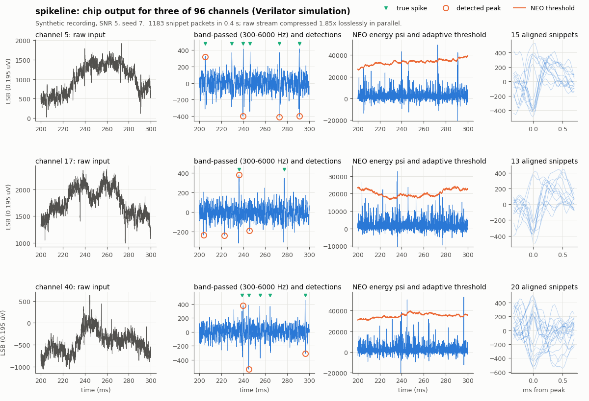
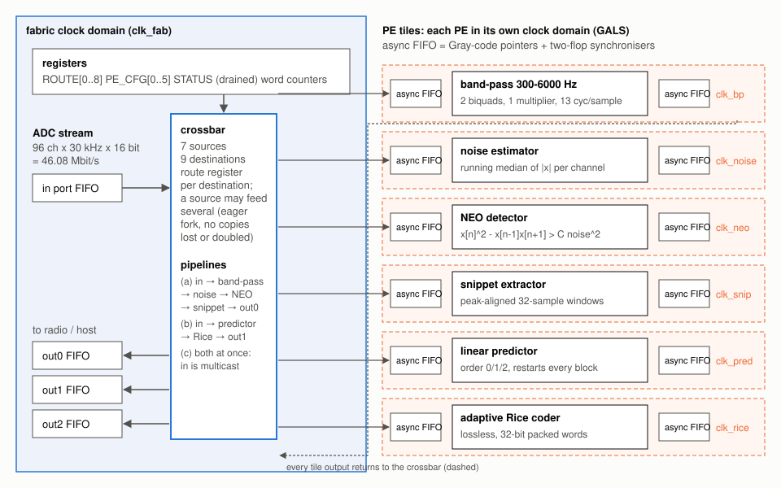

# spikeline（腦機介面訊號晶片）

一顆給植入式腦機介面用、可重新組態的神經訊號處理晶片，用 SystemVerilog 設計、
以模擬驗證。輸入是 96 個電極 × 每秒 30,000 次 × 16 位元（每秒 4608 萬位元），
晶片可以找出神經脈衝（spike）並切下波形、把原始資料無損壓縮，或兩件事同時做；
每個處理單元都在自己的時脈域裡，用它的工作所需的最低頻率運作。

**這是根據已發表論文的學習用重新實作，不是新的研究。**
架構參考耶魯大學的 HALO 研究處理器（Karageorgos、Sriram、Bhattacharjee、
Manohar 等人）：一群各做一件事的加速器，每個在自己的時脈域，透過可設定的互連
讓軟體組出不同的處理管線。本專案與耶魯大學或 HALO 作者沒有任何關係，沒有使用
他們的程式碼，而且實作的演算法和 HALO 不同（見「相關研究」）。

[English](README.md) · [課程式完整報告](docs/report.md) ·
[設計說明](docs/DESIGN.md) · [導讀（給初學者）](docs/導讀.zh-TW.md)



*由 `make demo` 從模擬晶片吐出的資料畫成：帶通後訊號和雜訊估計（從空的輸出埠監看）、
波形片段封包和峰值時間。能量曲線是用晶片的帶通輸出依 PE 的公式重算，門檻來自晶片的雜訊字；
原始輸入和真實 spike 時間來自資料產生器。合成資料，SNR 5。*

## 裡面有什麼



| 處理單元（PE） | 做什麼 | 每個樣本幾拍 |
|---|---|---|
| 帶通濾波器 `rtl/pe_bandpass.sv` | 300–6000 Hz，4 階 Butterworth，兩個直接 I 型雙二階節，一個 24×18 乘法器輪流使用 | 13 |
| 雜訊估計 `rtl/pe_noise.sv` | 每個通道 \|x\| 的移動中位數（不用排序的 MAD 雜訊估計） | 1 |
| NEO 偵測器 `rtl/pe_neo.sv` | ψ = x[n]² − x[n−1]x[n+1] > C × 雜訊²，含不應期；另有振幅模式可比較 | 1 |
| 波形擷取 `rtl/pe_snippet.sv` | 從每通道的環形緩衝區切出 32 點、對齊在峰值的片段 | 1，每個 spike 另加 33 |
| 預測器 `rtl/pe_predict.sv` | 0/1/2 階線性預測，每個區塊重新開始，區塊可單獨解碼 | 1 |
| Rice 編碼器 `rtl/pe_rice.sv` | 自適應 Rice 碼（LOCO-I 式的 k）、跳脫碼、MSB 優先的 32 位元字 | 1（跳脫碼 2） |

周邊：每個目的地一個路由暫存器、支援一對多（multicast）的交換器
（`rtl/sl_xbar.sv`）；把 PE 放進自己時脈域、前後各一個非同步 FIFO
（格雷碼指標、兩級同步器）的「磚」（`rtl/sl_tile.sv`、`rtl/sl_async_fifo.sv`）；
跨時脈域傳設定值的切換式交握（`rtl/sl_cfg_cdc.sv`）；以及路由、PE 設定、
「已排空」狀態位元和計數器的暫存器區（`rtl/spikeline_top.sv`）。
每個 PE 在 `model/slmodel.py` 都有位元精確的 numpy 模型。

管線就是寫暫存器。例如「同時偵測 spike 和壓縮」（管線 c）：

```
ROUTE[帶通]   = in        ROUTE[預測器] = in        （輸入一對多）
ROUTE[雜訊]   = 帶通
ROUTE[NEO]    = 雜訊      ROUTE[Rice]   = 預測器
ROUTE[擷取]   = NEO       ROUTE[out1]   = Rice
ROUTE[out0]   = 擷取
```

## 結果

所有數字都是在這台機器（Apple M5，同時有其他工作在跑）上用列出的指令量到的。
只有模擬：沒有在 FPGA 或真的晶片上跑過。

**驗證**（`make test`：lint、18 個黃金模型測試、11 組 cocotb 單元測試、
29 個整顆晶片的 Verilator 測試）

* 每個 PE 在隨機的 valid/ready 間隔下，和黃金模型逐字相同（cocotb + Icarus）。
* 非同步 FIFO 在 1:30 到 30:1 的 7 種時脈比例、隨機相位、模擬亞穩態
  （剛改變的同步器位元隨機晚一拍）下，沒有掉資料、重複或亂序。
* 整顆晶片（Verilator，7 個獨立時脈）在三條管線、執行中重新組態
  （偵測 → 排空 → 壓縮 → 排空 → 兩者）、以及 24 組隨機設定
  （路由、PE 參數、時脈週期與相位、抖動、背壓；GALS、全同步、混合三種組建）
  下都和模型一致。
* `make metrics` 讓晶片跑 12 段各 2 秒的資料（6 種 SNR × 2 種偵測模式）：
  每段 158–174 萬個輸出字，全部和模型相同，壓縮資料解回來和輸入一模一樣。
* 三種組建的 `verilator --lint-only -Wall` 都沒有警告。
* `make mutants`：在 RTL 和解碼器放 19 個單行 bug，全部被測試抓到
  （[docs/mutants.md](docs/mutants.md)）。

**Spike 偵測**（`make metrics`；門檻在另一段校正資料上決定；
每個 SNR 用 3 個種子 × 2 秒 × 96 通道；0.5 ms 內算命中；
[完整表格](docs/results/detection.md)）

| SNR | NEO 精確率 | NEO 召回率 | NEO F1 | 振幅模式 F1 |
|---:|---:|---:|---:|---:|
| 3 | 0.503 | 0.222 | 0.308 | 0.493 |
| 4 | 0.704 | 0.498 | 0.583 | 0.833 |
| 5 | 0.794 | 0.778 | 0.786 | 0.949 |
| 6 | 0.826 | 0.930 | 0.875 | 0.962 |
| 8 | 0.835 | 0.984 | 0.904 | 0.947 |

在這些合成資料上，簡單的振幅門檻（同一個 PE 的另一個模式）比能量運算子好；
[DESIGN.md](docs/DESIGN.md) 解釋為什麼這取決於背景雜訊的模型。

**壓縮**（`make metrics`；[細節](docs/results/compression.md)）：
1 階預測 + 自適應 Rice 在 SNR 5 時壓縮 **1.853 倍**（每個 16 位元樣本 8.63 位元，殘差的零階熵是 8.42 位元），幾乎不隨 SNR 改變；0 階 1.313 倍、2 階 1.729 倍。每 128 個 frame（4.3 毫秒）一個可單獨解碼的區塊；區塊縮到 8 個 frame 時壓縮率降到 1.562 倍，放大到 2048 個 frame 時升到 1.876 倍。每一段都解碼回來和輸入完全相同。

**吞吐量與最低時脈**（`make bench`；[細節](docs/results/throughput.md)）。
即時需求是每秒 288 萬個樣本。

| PE | 量到的每樣本拍數 | 最壞情況 | 最低時脈（最壞情況） | 即時檢查 |
|---|---:|---:|---:|---|
| 帶通 | 13.000 | 13.000 | 37.44 MHz | 38.563 MHz 時 0 次漏接，36.317 MHz 時 287192 次 |
| 雜訊 | 1.000 | 1.000 | 2.88 MHz | 2.966 MHz 時 0 次漏接，2.794 MHz 時 287331 次 |
| NEO | 1.000 | 1.000 | 2.88 MHz | 2.966 MHz 時 0 次漏接，2.794 MHz 時 286836 次 |
| 擷取 | 1.056 | 2.500 | 7.20 MHz | 這段資料不漏接的最低時脈：4.379 MHz |
| 預測器 | 1.000 | 1.000 | 2.88 MHz | 2.966 MHz 時 0 次漏接，2.794 MHz 時 287317 次 |
| Rice | 1.000 | 2.000 | 5.76 MHz | 這段資料不漏接的最低時脈：2.905 MHz |

**延遲**（即時輸入，時脈 fab 10 MHz, bp 40 MHz, noise 5 MHz, neo 5 MHz, snip 8 MHz, pred 3.2 MHz, rice 3.6 MHz）：NEO 偵測結果在樣本被取樣後 37.4 微秒（中位數；37.0–41.0 微秒）離開晶片，其中 33.3 微秒是能量運算子必須等下一個樣本；波形片段在峰值樣本後 738.4 微秒送出，其中 733.3 微秒是在等峰值後的 21 個樣本。

**資源**（`make synth`：Yosys `synth_xilinx`，Spartan-7 XC7S50，沒有佈局繞線；
[報告](synth/report.md)）

| Block | LUT | LUTRAM | FF | BRAM36 | DSP48E1 | CARRY4 |
|---|---:|---:|---:|---:|---:|---:|
| band-pass filter (2 biquads, 1 multiplier) | 430 | 0 | 138 | 2 | 1 | 33 |
| noise estimator (median tracker) | 193 | 12 | 66 | 0 | 0 | 28 |
| NEO / amplitude detector | 216 | 21 | 35 | 0 | 6 | 22 |
| snippet extractor (incl. ring buffer) | 246 | 15 | 100 | 2 | 0 | 36 |
| linear predictor | 206 | 18 | 54 | 0 | 0 | 19 |
| adaptive Rice coder + bit packer | 894 | 12 | 152 | 0 | 0 | 34 |
| **six PEs** | 2,185 | 78 | 545 | 4 | 7 | 172 |
| **whole chip** (PEs + async FIFOs + crossbar + registers) | 4,307 | 190 | 1,832 | 4 | 7 | 252 |

**切換活動量**記在 [docs/results/activity.md](docs/results/activity.md)，
是 Verilator toggle coverage 算出的每樣本訊號翻轉次數，只是相對的參考指標；
本專案不報告任何功耗數字，因為沒有開源的功耗簽核工具可用。

## 和 HALO 比較（論文發表的數字 vs. 本專案量到的）

| | HALO（IEEE Micro 2023 發表） | spikeline（本專案量測） |
|---|---|---|
| 輸入 | 96 通道 × 30 kHz × 16 位元 = 46 Mbps | 相同（46.08 Mbit/s） |
| 實作 | 12 nm 下線（部分 PE）、28 nm 合成，Cadence 工具 | RTL，模擬；只有 FPGA 合成數字 |
| spike 管線 | NEO → THR → GATE | 帶通 → 雜訊 → NEO → 擷取 |
| 壓縮 | LZ4、LZMA（LZ → MA → RC）、DWT | 線性預測 + 自適應 Rice |
| NEO PE 時脈 | 3 MHz（28 nm）、14 MHz（12 nm） | 每樣本 1 拍：最低 2.88 MHz，2.97 MHz 驗證通過 |
| 各 PE 時脈 | 3–180 MHz | 最壞情況 2.88–37.44 MHz |
| 功耗 | 每條管線最多 6.3 mW（12 nm） | 未量測（沒有簽核工具） |

HALO 的數字抄自論文，沒有重現。NEO 時脈相近是可以預期的，不代表什麼：
兩者都是每拍處理一個樣本。

## 建置與測試

需要 Verilator（5.020 以上）、Icarus Verilog（12 以上）、Yosys（0.33 以上）、
Python 3.11 以上、C++17 編譯器。所有指令都在專案根目錄執行；Makefile 只用相對路徑，
所以專案放在名稱有空白或中文的資料夾也沒問題。

```sh
make venv          # 第一次：建立 .venv，裝 numpy、scipy、matplotlib、cocotb、pytest
make test          # lint + 黃金模型 + cocotb 單元測試 + 整顆晶片測試（幾分鐘）
make demo          # build/demo/demo.png
make metrics       # 偵測與壓縮表格，含硬體比對（約 7 分鐘）
make bench         # 每樣本拍數、即時檢查、延遲（10–20 分鐘）
make quant         # 濾波器定點數分析
make synth         # Yosys 資源報告
make mutants       # 突變測試（幾分鐘）
make activity      # 切換活動量參考指標
```

在 Mac 上可以直接雙擊 `跑跑看.command`：它會檢查工具、編譯模擬器、跑示範並打開圖片
（缺什麼會用中文告訴你）。CI（`.github/workflows/ci.yml`）用 Ubuntu 套件的
Verilator 5.020、Icarus 12、Yosys 0.33；Yosys 0.33 也在本機（透過 `yowasp-yosys`
套件）跑過，可以合成，只是 LUT 和 DSP 用量比 0.69 多。本機沒有 Verilator 5.020
和 Icarus 12 可以測。

## 限制

* 只有模擬。沒有時序收斂、沒有佈局、沒有上板；Yosys 只對應到 7 系列元件，不給時序。
* 沒有功耗數字；活動量只是相對參考。
* 只有合成資料。產生器的雜訊模型（白雜訊、1/f、大量遠方小 spike）決定了各偵測器的表現；
  沒有加入有明確授權的公開真實錄音。
* 模擬看不到亞穩態。CDC 設計遵循標準做法，測試也注入了延遲到達，但那只能證明協定正確，
  不能證明沒有任何 CDC 問題（DESIGN.md 有一個測試分辨不出來的例子）。
* 路由和 PE 設定只能在晶片排空時改（STATUS 第 16 位元），硬體不會擋。
* 晶片輸入只有 16 字的 FIFO；突發型 PE（擷取、Rice）要靠整條路徑上的時脈餘裕才能即時吸收突發
  （量測見 [throughput.md](docs/results/throughput.md)）。
* 各 PE 相信 tag 是合法的通道編號（< 96）。
* 沒有 HALO 有的加密、無線電、ADC 或微控制器。

## 相關研究

* **HALO**：I. Karageorgos、K. Sriram、J. Vesely、M. Wu、M. Powell、D. Borton、
  R. Manohar、A. Bhattacharjee，〈Hardware-software co-design for brain-computer
  interfaces〉，ISCA 2020；〈Balancing specialized versus flexible computation in
  brain-computer interfaces〉，IEEE Micro 41(3)，2021；〈HALO: A Hardware-Software
  Co-Designed Processor for Brain-Computer Interfaces〉，IEEE Micro，2023。
  本專案架構點子的來源：PE 各自的時脈域、可設定互連、軟體組出管線、96 × 30 kHz × 16 位元。
  HALO 的 PE（NEO、THR、GATE、LZ、MA、RC、DWT、FFT、XCOR、BBF、SVM、AES）已經下線；
  本專案用不同的一組 PE 重做這個結構，而且只有模擬。
* **SCALO**：K. Sriram 等人，〈SCALO: An Accelerator-Rich Distributed System for
  Scalable Brain-Computer Interfacing〉，ISCA 2023：多顆類 HALO 植入物無線連網、
  裝置上有儲存。本專案沒有嘗試。
* R. Pothukuchi、A. Bhattacharjee，〈The Brain-Computer Interfacing Landscape for
  Computer Architects〉，SIGARCH 部落格，2024 年 1 月：說明溫升 1°C、毫瓦級功耗、
  無線頻寬等限制，為什麼要在植入物上處理。
* NEO 偵測 spike：J. F. Kaiser，ICASSP 1990；S. Mukhopadhyay、G. C. Ray，IEEE TBME，1998。
* 中位數門檻：R. Q. Quiroga、Z. Nadasdy、Y. Ben-Shaul，Neural Computation，2004。
* FPGA 上的 spike 偵測：〈FPGA Design Integration of a 32-Microelectrodes Low-Latency
  Spike Detector in a Commercial System for Intracortical Recordings〉，Digital (MDPI)，2021
  （依其摘要，先用 Butterworth 高通濾波再用平滑 NEO）。
* 晶片上的神經資料壓縮：J. N. Y. Aziz 等人，256 通道錄音與差分壓縮微系統，IEEE JSSC，2009。
* 自適應 Golomb-Rice 參數：M. J. Weinberger、G. Seroussi、G. Sapiro，LOCO-I，IEEE TIP，2000。
* 非同步 FIFO：C. E. Cummings，SNUG 2002。

就我所知 HALO 沒有公開的 RTL；本專案除了上面列出的點子之外，不宣稱和它的設計一致。

## 檔案配置

```
rtl/            SystemVerilog：六個 PE、非同步 FIFO、同步器、磚、交換器、頂層
model/          位元精確黃金模型、獨立解碼器、合成錄音產生器
sim/            Verilator 外殼：7 個時脈、ADC 節拍、背壓、暫存器腳本
tests/model     黃金模型測試          tests/unit    cocotb 單元測試（Icarus）
tests/system    整顆晶片測試（Verilator）
tools/          係數、指標、效能、定點分析、合成報告、突變測試、示範圖
synth/          合成報告              docs/         報告、設計說明、結果、導讀
```

## 授權

MIT，見 [LICENSE](LICENSE)。
